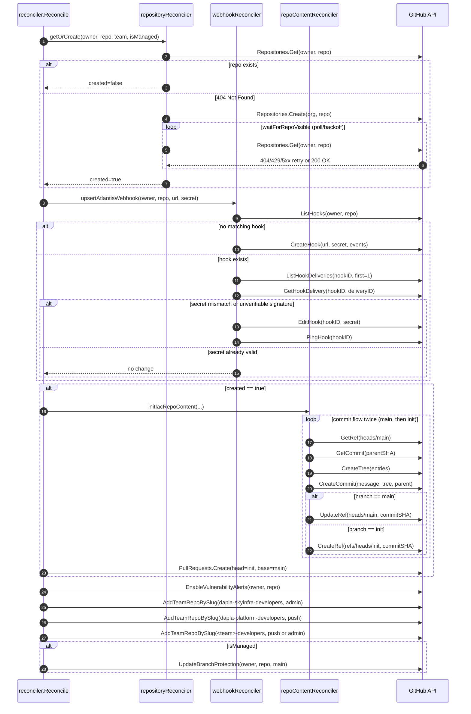

# Github IAC Repo Reconciler

This package replaces the github module in the old terraform setup

## Github app

Overview over endpoints in Github used, and which permissions the github app requires for this reconciler to work.

### Permissions needed

https://docs.github.com/en/rest/authentication/permissions-required-for-github-apps?apiVersion=2026-03-10

| Permission                 | Level        | Covered Go Function(s)                                                         |
| -------------------------- | ------------ | ------------------------------------------------------------------------------ |
| Repository: Metadata       | Read-only    | repositories.Get                                                               |
| Repository: Contents       | Read & write | GetRef, CreateRef, UpdateRef, GetCommit, CreateCommit, CreateTree              |
| Repository: Pull requests  | Read & write | pullRequests.Create                                                            |
| Repository: Administration | Read & write | repositories.Create, EnableVulnerabilityAlerts, UpdateBranchProtection         |
| Repository: Webhooks       | Read & write | ListHooks, CreateHook, EditHook, PingHook, ListHookDeliveries, GetHookDelivery |
| Repository: Workflows      | Read & write | (commit of github action file)                                                 |
| Organization: Members      | Read-only    | AddTeamRepoBySlug                                                              |

### `gitClient` (`repo_content.go`)

- GetRef: GET /repos/{owner}/{repo}/git/ref/{ref}
- CreateRef: POST /repos/{owner}/{repo}/git/refs
- UpdateRef: PATCH /repos/{owner}/{repo}/git/refs/{ref}
- GetCommit: GET /repos/{owner}/{repo}/git/commits/{sha}
- CreateCommit: POST /repos/{owner}/{repo}/git/commits
- CreateTree: POST /repos/{owner}/{repo}/git/trees

### `pullRequestsClient` (`reconciler.go`)

- Create: POST /repos/{owner}/{repo}/pulls

### `teamsClient` (`reconciler.go`)

- AddTeamRepoBySlug: PUT /orgs/{org}/teams/{team_slug}/repos/{owner}/{repo}

### `repositoriesReconcilerClient` (`repository.go`)

- Get: GET /repos/{owner}/{repo}
- Create: POST /orgs/{org}/repos
- EnableVulnerabilityAlerts: PUT /repos/{owner}/{repo}/vulnerability-alerts
- UpdateBranchProtection: PUT /repos/{owner}/{repo}/branches/{branch}/protection

### `webhookReconcilerClient` (`webhook.go`)

- ListHooks: GET /repos/{owner}/{repo}/hooks
- CreateHook: POST /repos/{owner}/{repo}/hooks
- EditHook: PATCH /repos/{owner}/{repo}/hooks/{hook_id}
- PingHook: POST /repos/{owner}/{repo}/hooks/{hook_id}/pings
- ListHookDeliveries: GET /repos/{owner}/{repo}/hooks/{hook_id}/deliveries
- GetHookDelivery: GET /repos/{owner}/{repo}/hooks/{hook_id}/deliveries/{delivery_id}

## Reconcile flow: iac -> GitHub API (sequence)

## Error handling

### Dapla team repo not initialized

We must manualy init the dapla team iac repo if reconcile fails.
This is due to we don't want to check the content of every repo to see if they have been initialized (most of them has, it is a one time thing), thus we accept the trade of of having to do this manually if a error occures which stops the reconciler from doing it.

A script is provided to ease this. Eiter via mise, or run directly with go:

- Mise: `mise run template-dapla-team-iac-repo -managed=true -team example [-output=<my path>]`
- go: Cd to reconcilers folder, and run `go run ./cmd/dapla-team-repo-init`, with same flags as for mise. Run with no flag for usage.
