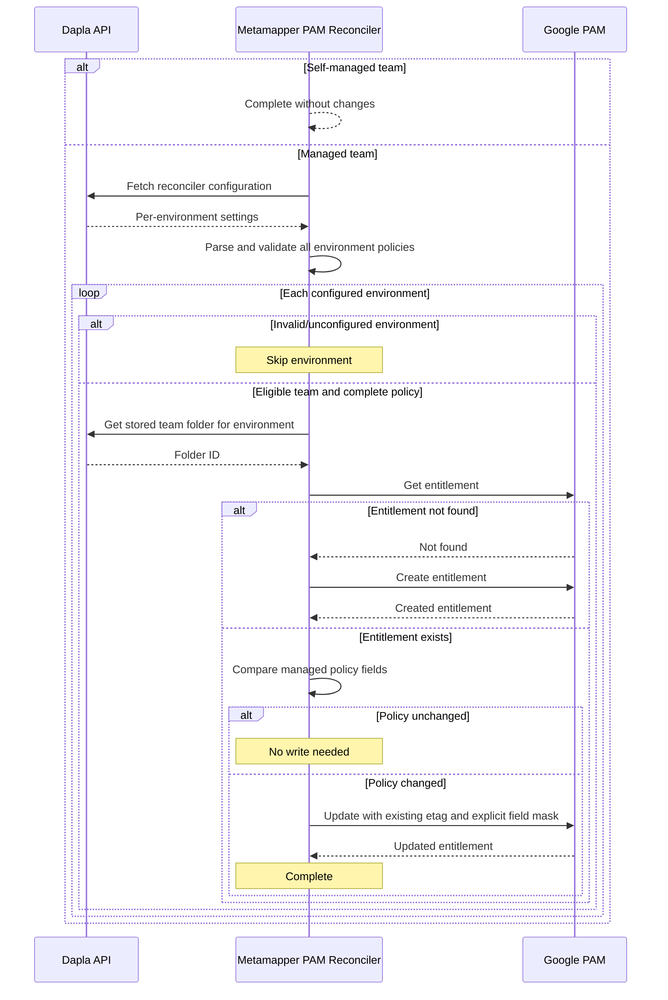

# Metamapper reconciler

This reconciler exists in order to give the Metamapper application access to read files from Managed team buckets. The goal is to minimize the scope of access, both in terms of which resources may simultaneously be accessed and in terms of time. The Google Cloud Platform (GCP) system Privileged Access Management (PAM) is chosen to implement this.

This reconciler creates a PAM entitlement on each team's folder, which gives a configured role to configured principals. This is further scoped by an IAM Condition which is used to constrain access to "produkt" and "delt" buckets.

## Reconciler configuration

Each environment has independent configuration with environment prefixes. If a required parameter is not present for an environment, the environment is skipped.

| TEST key                  | PROD key                  | Value                                                                                                                           |
| ------------------------- | ------------------------- | ------------------------------------------------------------------------------------------------------------------------------- |
| `test_entitlement_id`     | `prod_entitlement_id`     | Required PAM entitlement ID: 4-63 lowercase letters, digits or hyphens, starting with a letter                                  |
| `test_principals`         | `prod_principals`         | Comma-separated IAM principal identifiers, e.g. `user:reader@example.com,group:readers@example.com`                             |
| `test_role`               | `prod_role`               | Full IAM role name, e.g. `roles/storage.objectViewer`                                                                           |
| `test_max_grant_duration` | `prod_max_grant_duration` | Go duration between `30m` and `168h`, e.g. `1h`                                                                                 |
| `test_condition_template` | `prod_condition_template` | Go text template rendering an IAM CEL condition using `.TeamSlug` only                                                          |
| `test_team_allowlist`     | `prod_team_allowlist`     | Optional comma-separated list of exact, case-sensitive team slugs. Empty or unset allows all Managed teams in that environment. |

## IAM condition

The IAM condition needs to be templated with the `TeamSlug` in order to scope the access suitably. See below for an example condition which may be used. This condition shall be supplied along with the other config.

:warning: This template example is read and used in tests so changing it may break tests.

```gotemplate
resource.type in ["storage.googleapis.com/Bucket", "storage.googleapis.com/Object"] &&
(
  resource.name.startsWith({{printf "%q" (printf "projects/_/buckets/ssb-%s-data-produkt" .TeamSlug)}}) ||
  resource.name.startsWith({{printf "%q" (printf "projects/_/buckets/ssb-%s-data-delt" .TeamSlug)}})
)
```

The example allows the following bucket names for that team and environment:

- `ssb-<team>-data-produkt-<env>`
- `ssb-<team>-data-delt-<kortnavn>-<env>`
- `ssb-<team>-data-delt-delomat-<kortnavn>-<env>`

The `data-delt-` prefix covers both shared-data formats, with non-empty short
names. `ssb-<team>-data-kilde-<env>` and other bucket families do not match the
allowlist.

See the [IAM resource-name condition reference](https://cloud.google.com/iam/docs/conditions-attribute-reference#resource-name).

## Deletion

Deletion is not yet implemented. However, if a team is deleted then the PAM entitlement will also be deleted since it is applied to the team folder which will be deleted in this case.

## Sequence diagram


